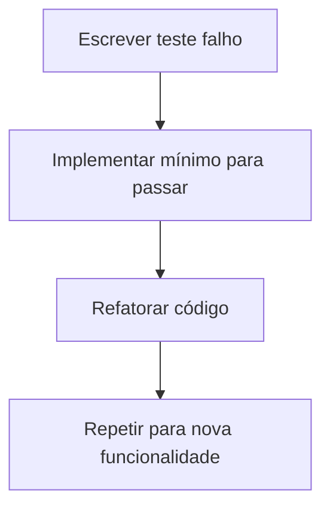

## Princípio Fundamental
- **Forçar a barra** começando por pensar no teste primeiro
- É mais fácil pensar **no que testar** para depois pensar em **como desenvolver**
- Desenvolvimento **guiado por comportamentos esperados**
## Ciclo do TDD (Red-Green-Refactor)
1. **Red**: Escreve um teste que falha (define o comportamento desejado)
2. **Green**: Implementa o mínimo necessário para o teste passar
3. **Refactor**: Melhora o código sem alterar o comportamento

## Benefícios do TDD
### Qualidade Técnica
- **Força a escrita de testes unitários** consistentemente
- **Desacopla as classes** naturalmente
- **Aprimora a API e o design** do código de produção
- **Favorece alta testabilidade** desde o início

### Manutenibilidade
- **Evita que o desenvolvedor esqueça** funcionalidades críticas
- **Permite evoluir o código** com segurança
- **Aplica regressão** automaticamente
- **Documenta o código** através dos testes

### Experiência do Desenvolvedor
- **Comporta-se como usuário** da classe
- **Feedback rápido** sobre decisões de design
- **Confiança** para fazer mudanças
- **Foco incremental** no desenvolvimento

## Quando o TDD é Difícil de Aplicar?
- **Código macarrônico** com baixa coesão e alto acoplamento
- **Arquitetura não testável** desde o início
- **Legacy code** sem estrutura para testes
- **Dependências externas** complexas não mockadas

## Padrões de TDD

### Padrão 1: API Definition
- **Objetivo**: Definir como os clientes usarão a classe
- **Primeiro teste**: Define a superfície da API, não a implementação interna
- **Implementação trivial**: Criar o cenário mais simples possível
- **Foco**: Experiência do usuário da classe

### Padrão 2: Differential Test
- **Definir o passo básico** incrementalmente
- **Exemplo (elevador)**:
  1. Testar estado parado inicial
  2. Testar movimento para cima
  3. Testar movimento para baixo
- **Princípio**: Cada teste deve motivar **mudanças diferentes** no código
- **Cuidado**: Evitar testes complexos que quebram o feedback rápido

### Padrão 3: Exceptional Limit
- **Proteger contra mau uso** (usuários "espíritos de porco")
- **Testar cenários inválidos** e tratamento de exceções
- ![[Pasted image 20250909221701.png]]
- **Exemplos**:
  - `pop()` em pilha vazia
  - Divisão por zero
  - Arquivo não encontrado
  - Entradas nulas ou inválidas
- **Foco**: Resiliência e robustez da aplicação

### Padrão 4: Everything Working Together
- **Teste de integração controlado**
- **Verificar interseções** entre funcionalidades
- **Garantir integração** adequada dos componentes
- **Não confundir** com adição de nova funcionalidade

## Fluxo de Trabalho com TDD

### Pré-condições
- Entender os **requisitos** do usuário
- Definir **critérios de aceitação** claros
- Identificar **casos de uso** principais e excepcionais

### Desenvolvimento Iterativo

### Regressão e Qualidade
- **Suite de testes completa** deve passar sempre
- **Build quebrado** é prioridade máxima
- **Refactoring seguro** garantido pelos testes
- **Deploy confiável** com testes automatizados

## Boas Práticas no TDD

### Nomenclatura de Testes
- Nomes descritivos e autoexplicativos
- Padrão: `[Método]_[Cenário]_[ResultadoEsperado]`
- Exemplo: `CalculateSalary_EmployeeWithOvertime_ReturnsCorrectValue`

### Organização dos Testes
- **Testes independentes** entre si
- **Setup e cleanup** adequados
- **Arrange-Act-Assert** pattern claro
- **Mocks e stubs** bem gerenciados

### Manutenção
- **Refatorar testes** junto com o código de produção
- **Eliminar testes frágeis** ou duplicados
- **Manter testes rápidos** e confiáveis

## Métricas de Sucesso com TDD
- **Alta cobertura de testes** (80%+)
- **Tempo rápido de execução** dos testes
- **Baixa taxa de bugs** em produção
- **Facilidade de adicionar** novas funcionalidades
- **Feedback contínuo** durante o desenvolvimento

## Ferramentas Recomendadas
- **xUnit** frameworks (JUnit, NUnit, pytest)
- **Mocking frameworks** (Mockito, Moq, Sinon.js)
- **Code coverage** (JaCoCo, Coverage.py, Istanbul)
- **CI/CD integration** (GitHub Actions, Jenkins, GitLab CI)

> **Nota**: TDD não é apenas sobre testes - é sobre **design emergente**, **confiança no código** e **qualidade sustentável**.

[[Teste de Unidade]] | [[Refactoring]] | [[Design Patterns]] | [[CI-CD]] | [[Clean Code]]